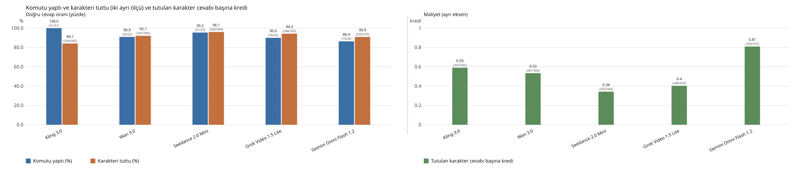

# Character Consistency Bench (TUTAR)

TUTAR is a small benchmark that measures whether video models can keep a character intact while making that character do something.

## What it measures

It asks two questions and scores them separately:

1. Did the model do the command?
2. Did it keep the character (Aikyo) while doing it?

Input: one start image and 20 commands. The commands were written in Turkish; the models get an English translation. Each of the five models generates one video per command: 100 attempts, 98 clips, 2 safety refusals.

## What it does not measure

- General video quality
- Audio (the judge only looks at frames; for the two models where audio could not be turned off, it was removed afterwards)
- Speed
- Price

## How it is scored

- The judge is Claude. Code extracts 10 frames per second from each video, plus a top-half and bottom-half crop of every frame, and the judge answers by looking at these frames.
- There are 101 scored questions (plus 2 unscored information questions, which do not enter the score or the breakdown). Each question can get one of four answers: yes, no, not visible, no judge answer. If a model generates all 20 of its clips, that gives 343 scored answers, or 1,715 for five models. The real number is lower because one model could not generate 2 clips.
- The result is two separate columns: "did the command %" and "kept the character %". They are not merged into one number. A breakdown by question type (common, group, specific) is also given. The results table also has a "generated: N/20" column per model.
- Human check: I score 20 clips by hand, chosen by code with a fixed seed, without seeing the judge's answers. The agreement threshold between human and judge is 85%. If it comes out lower, the result is published as it is.
- The rule for clips that could not be generated (refused) was written after the videos were made: that command counts as not done in the "did" score and does not enter the "kept" score (`PROTOCOL.md`).
- The "kept the character" score is also shown over the 18 commands that all five models generated; this row was added after the videos were made (`PROTOCOL.md`).

## Limits

- One character
- One start image
- One try (each command is generated once per model)
- Three of the five models are cheap tiers
- A single frame-based judge (no second judge)
- 20 commands
- 77 of the 103 questions were written by hand; the rest were written by AI or are unconfirmed readings

## What is private and why

The questions, the answer key, the start image, the videos and the frames are private. If the questions were public, a model or provider could be tuned to their answers. These files will live in a gated (manually approved) dataset on Hugging Face. This repo holds only the code, the rules, the 20 commands, the results table, the limits and the SHA-256 fingerprints of the private files. In the open files, questions appear only by ID.

See `PROTOCOL.md` for the process and the freezing rules. It is written in Turkish.

Limits noticed after generation are in the `PROTOCOL.md` section "Üretimden sonra görülen sınırlar (26 Kasım 2026)".

The rules for running the judge were written in `PROTOCOL.md` before the judge ran.

## Results

Full tables, counts and charts are in [`results/RESULTS.md`](results/RESULTS.md) (in Turkish). Read the two columns separately; they are not added up.

| Model | Generated | Did the command | Kept the character |
|---|---|---|---|
| Kling 3.0 | 20/20 | 100.0% (21/21) | 84.1% (254/302) |
| Wan 3.0 | 20/20 | 90.9% (20/22) | 92.1% (281/305) |
| Seedance 2.0 Mini | 20/20 | 95.5% (21/22) | 96.1% (292/304) |
| Grok Video 1.5 Lite | 20/20 | 90.0% (18/20) | 94.3% (248/263) |
| Gemini Omni Flash 1.2 | 18/20 | 86.4% (19/22) | 90.9% (250/275) |

**The human check did not pass.** I scored 20 clips by hand without seeing the judge's answers. Human and judge agreed on 80.2% of answers (275/343); the threshold written in advance was 85%. So this table is one judge's reading that matches a human 80.2% of the time, not a settled ranking.

Most of the gap comes from 39 answers the judge never gave in these 20 clips (2 of the 20 got no judge answers at all); each of those counts as a disagreement. Where the judge did answer, agreement is 90.5% (275/304). That second number was not the one I committed to, so it does not replace the first.

Other things to keep in mind: there is one try per command, so small differences between models were not tested for significance, and the denominators differ between models because of missing judge answers.
