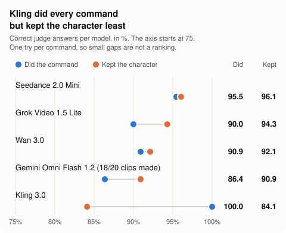
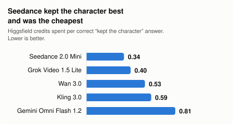
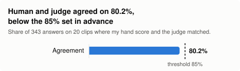
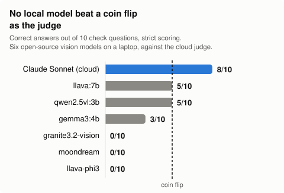

# Character Consistency Bench (TUTAR)

TUTAR is a small benchmark that measures whether video models can keep a character intact while making that character do something.

## Links

| What | Where |
|---|---|
| Results page (mini leaderboard) | https://biontra.github.io/character-bench.html |
| Dataset (gated, manual approval) | https://huggingface.co/datasets/Biontra/character-consistency-bench |
| Full results and charts | [`results/RESULTS.md`](results/RESULTS.md) |
| Rules written before the runs | [`PROTOCOL.md`](PROTOCOL.md) |
| The 20 commands | [`data/commands.json`](data/commands.json) |
| Local model side test | [`results/local_models/README.md`](results/local_models/README.md) |
| My questions for the shared NEXA benchmark | https://github.com/nexa-lab-ai/nexa-bench/pull/3 |
| Portfolio | https://biontra.github.io |

## Built with

- Python 3, standard library only (no packages to install)
- ffmpeg, to cut each video into frames
- Claude Sonnet as the judge model
- Higgsfield, to generate the videos with the five models
- Ollama, for the local model side test

## What it measures

It asks two questions and scores them separately:

1. Did the model do the command?
2. Did it keep the character (Aikyo) while doing it?

Input: one start image and 20 commands. The commands were written in Turkish; the models get an English translation. Each of the five models generates one video per command: 100 attempts, 98 clips, 2 safety refusals.

## What it does not measure

- General video quality
- Audio (the judge only looks at frames; for the two models where audio could not be turned off, it was removed afterwards)
- Speed
- Price

## The questions

103 yes/no questions, 101 of them scored.

| Type | Count | What it checks |
|---|---|---|
| Common | 11 | Asked for every clip: is the character still the same? |
| Group | 7 | Asked for a group of similar commands |
| Specific | 64 | Asked for one command only |
| Did the command | 19 | Did the action in the command happen? |
| Information | 2 | Not scored |

Who wrote them: 77 by hand, 19 by AI, 3 by AI and approved by me, 4 are unconfirmed AI readings. The expected answer is "no" for 60 questions and "yes" for 41, so a judge that always says the same thing cannot score well.

## Example

A real command from the benchmark (all 20 are in [`data/commands.json`](data/commands.json)):

> She takes the plush toy and hugs it.

The model gets the start image and this sentence, and returns a 5 second video. The judge then answers a list of yes/no questions about that video.

The real questions are private, so here is the format with an **invented** scene that is not in the benchmark. Command: "He pours tea into the cup."

| Question | Type | Expected | What a wrong answer means |
|---|---|---|---|
| Does tea end up in the cup? | Did the command | yes | The action did not happen |
| Does the teapot have one spout in every frame? | Kept | yes | The object changed shape |
| Does the cup change colour during the clip? | Kept | no | The scene was not kept |
| Does his hand pass through the table? | Kept | no | Bodies and objects merged |

Each answer is one of: yes, no, not visible, no judge answer. A question counts as correct when the judge's answer matches the expected one. "Did the command" and "kept" are added up separately.

## How it is scored

- The judge is Claude. Code extracts 10 frames per second from each video, plus a top-half and bottom-half crop of every frame, and the judge answers by looking at these frames.
- There are 101 scored questions (plus 2 unscored information questions, which do not enter the score or the breakdown). Each question can get one of four answers: yes, no, not visible, no judge answer. If a model generates all 20 of its clips, that gives 343 scored answers, or 1,715 for five models. The real number is lower because one model could not generate 2 clips.
- The result is two separate columns: "did the command %" and "kept the character %". They are not merged into one number. A breakdown by question type (common, group, specific) is also given. The results table also has a "generated: N/20" column per model.
- Human check: I score 20 clips by hand, chosen by code with a fixed seed, without seeing the judge's answers. The agreement threshold between human and judge is 85%. If it comes out lower, the result is published as it is.
- The rule for clips that could not be generated (refused) was written after the videos were made: that command counts as not done in the "did" score and does not enter the "kept" score (`PROTOCOL.md`).
- The "kept the character" score is also shown over the 18 commands that all five models generated; this row was added after the videos were made (`PROTOCOL.md`).

## Limits

- One character
- One start image
- One try (each command is generated once per model)
- Three of the five models are cheap tiers
- A single frame-based judge (no second judge)
- 20 commands
- 77 of the 103 questions were written by hand; the rest were written by AI or are unconfirmed readings

## What is private and why

The questions, the answer key, the start image, the videos and the frames are private. If the questions were public, a model or provider could be tuned to their answers. These files live in a gated (manually approved) dataset on Hugging Face: [Biontra/character-consistency-bench](https://huggingface.co/datasets/Biontra/character-consistency-bench). The dataset page is public; the files open only after the owner approves an access request, and the license is evaluation only. This repo holds only the code, the rules, the 20 commands, the results table, the limits and the SHA-256 fingerprints of the private files. In the open files, questions appear only by ID.

See `PROTOCOL.md` for the process and the freezing rules. It is written in Turkish.

Limits noticed after generation are in the `PROTOCOL.md` section "Üretimden sonra görülen sınırlar (26 Kasım 2026)".

The rules for running the judge were written in `PROTOCOL.md` before the judge ran.

## Results

Full tables, counts and charts are in [`results/RESULTS.md`](results/RESULTS.md) (in Turkish). Read the two columns separately; they are not added up.

| Model | Generated | Did the command | Kept the character |
|---|---|---|---|
| Kling 3.0 | 20/20 | 100.0% (21/21) | 84.1% (254/302) |
| Wan 3.0 | 20/20 | 90.9% (20/22) | 92.1% (281/305) |
| Seedance 2.0 Mini | 20/20 | 95.5% (21/22) | 96.1% (292/304) |
| Grok Video 1.5 Lite | 20/20 | 90.0% (18/20) | 94.3% (248/263) |
| Gemini Omni Flash 1.2 | 18/20 | 86.4% (19/22) | 90.9% (250/275) |







**The human check did not pass.** I scored 20 clips by hand without seeing the judge's answers. Human and judge agreed on 80.2% of answers (275/343); the threshold written in advance was 85%. So this table is one judge's reading that matches a human 80.2% of the time, not a settled ranking.

Most of the gap comes from 39 answers the judge never gave in these 20 clips (2 of the 20 got no judge answers at all); each of those counts as a disagreement. Where the judge did answer, agreement is 90.5% (275/304). That second number was not the one I committed to, so it does not replace the first.

Other things to keep in mind: there is one try per command, so small differences between models were not tested for significance, and the denominators differ between models because of missing judge answers.

## Side test: local open-source models as the judge

Six open-source vision models (llava:7b, qwen2.5vl:3b, granite3.2-vision, gemma3:4b, moondream, llava-phi3) answered 10 of the check questions on a laptop. None beat chance (best 5/10; the Claude judge got 8/10 on the same questions). Details and limits: [`results/local_models/README.md`](results/local_models/README.md).



## How to run

Nothing to install. You need Python 3.

```bash
git clone https://github.com/Biontra/character-consistency-bench.git
cd character-consistency-bench
python3 -m unittest discover -s tests
```

This runs 317 tests. They check the scoring code, the result tables and that no private file or question text is in the repo.

To rebuild the result tables and charts you need the private question file from the gated dataset, saved as `secret/checks.json`:

```bash
python3 scripts/sonuc_uret.py --checks secret/checks.json --hakem-ham results/judge_raw.jsonl --uretim-kaydi uretim_kaydi --modeller data/models.json --cikti-dizin results --uyum-raporu results/uyum_raporu.json
```

Cutting videos into frames (`tutar/kareler.py`) expects ffmpeg at `/opt/homebrew/bin/ffmpeg` (macOS with Homebrew).

## What is in the repo

| Folder | Content |
|---|---|
| `tutar/` | Scoring, frame extraction, human-judge agreement |
| `scripts/` | Command-line steps: prepare the judge input, save answers, build results and charts |
| `tests/` | 317 tests |
| `data/` | The 20 commands, the model settings, fingerprints of the private files |
| `judge/` | The judge prompt, frozen before the judge ran |
| `results/` | Tables, charts, raw judge answers (question IDs only) |
| `uretim_kaydi/` | Generation log for each model and the credits spent |

File names and `PROTOCOL.md` are in Turkish because I wrote the rules in my own language first; this README is the English entry point.

## License

Code and public results: MIT, see [`LICENSE`](LICENSE). The gated dataset has its own terms (evaluation only).
